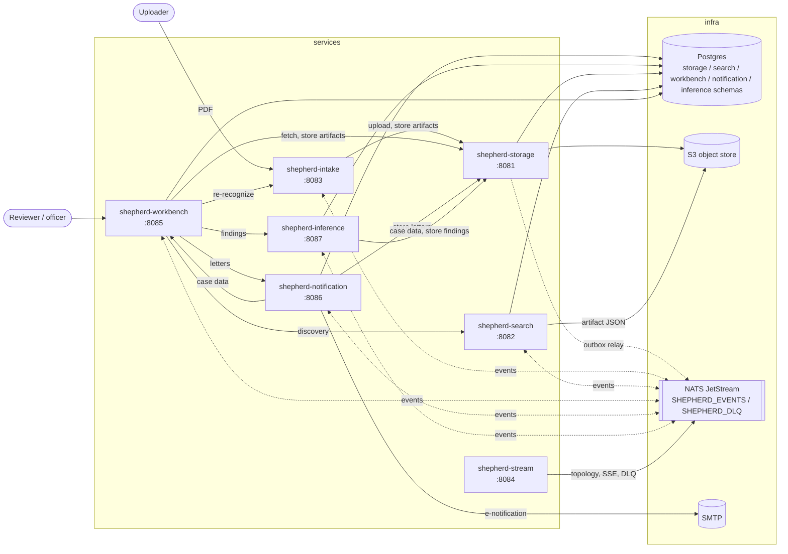
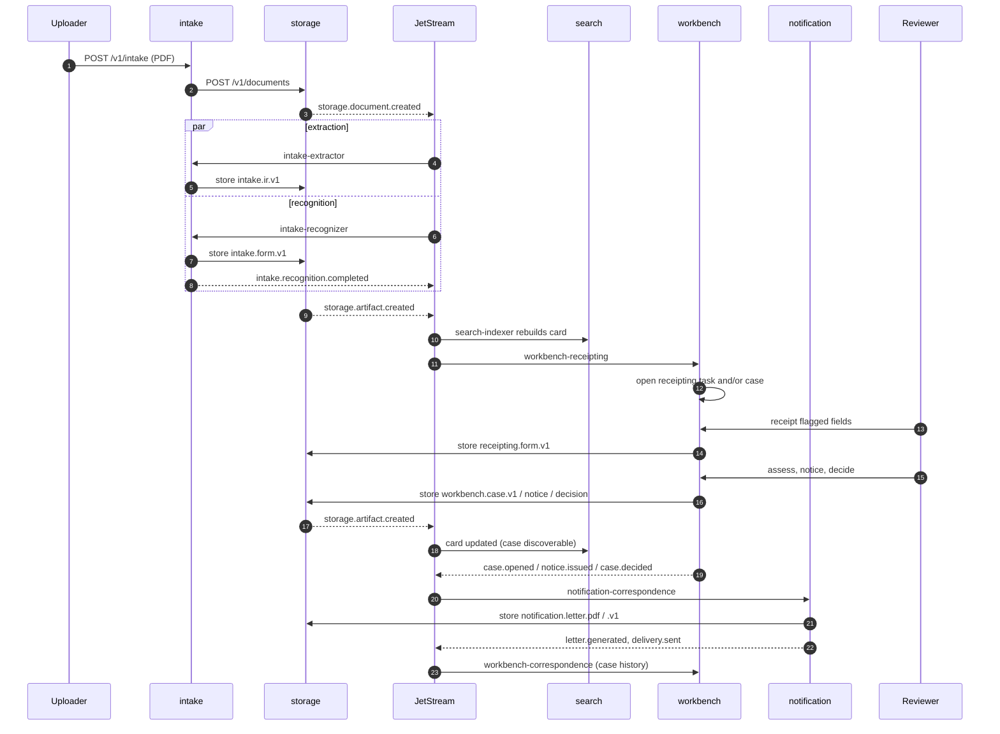
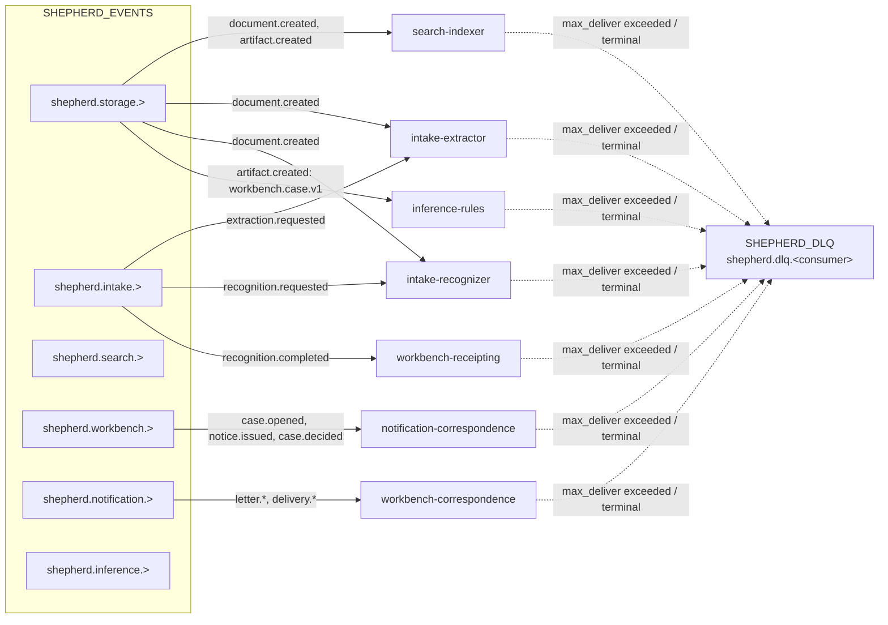
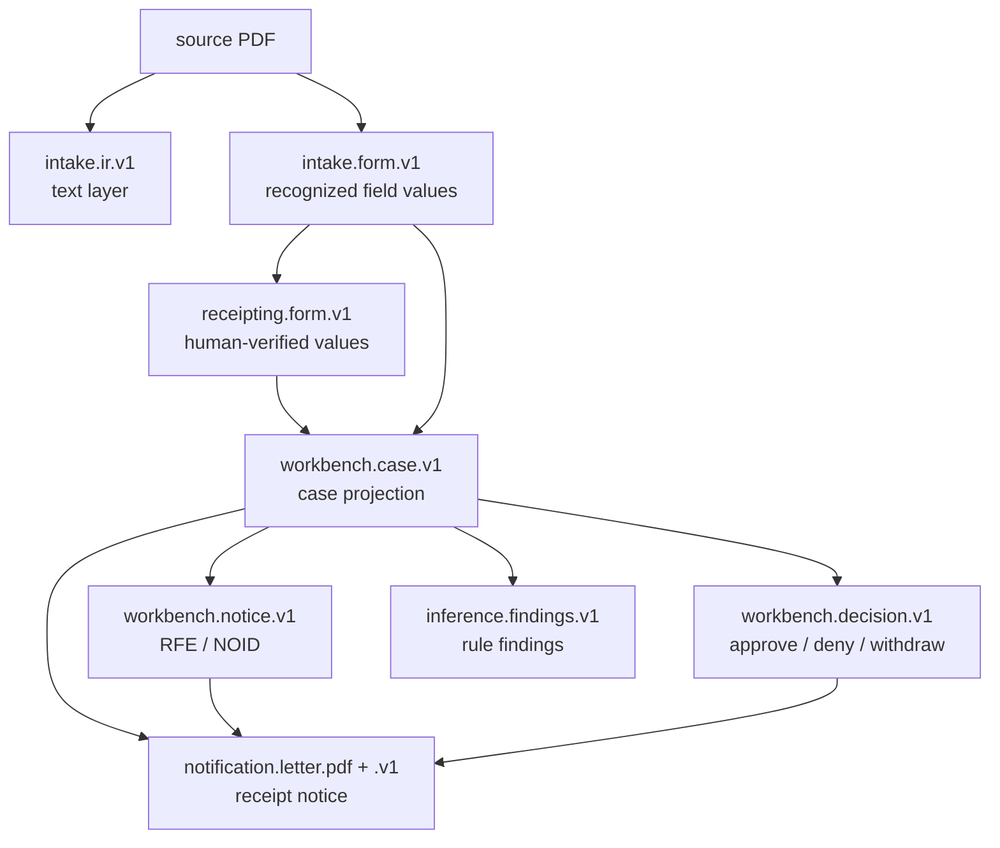
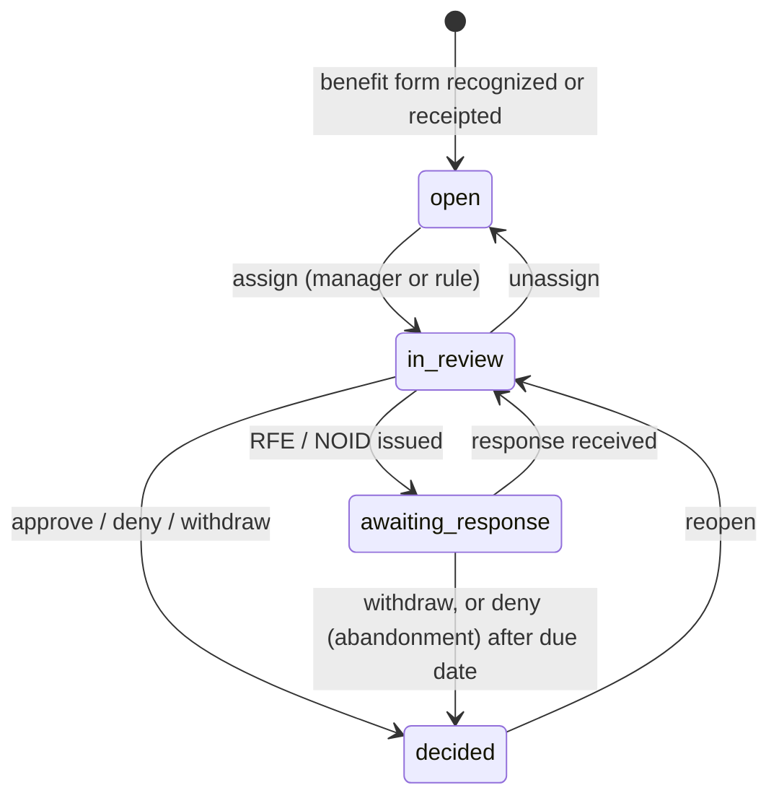

# shepherd

End-to-end document processing and adjudication. PDFs are stored, extracted, recognized, indexed and routed to human review; USCIS benefit forms are used as a usecase example. Cases are receipted, reviewed and decided, and notices are sent to applicants.

Rust workspace of services with one responsibility each. Services communicate through NATS JetStream events and storage's HTTP API; each owns a Postgres schema in a shared database.

## Architecture



Solid lines are HTTP or database access; dotted lines are events.

## Services

| Crate | Port | Responsibility |
|---|---|---|
| [shepherd-storage](shepherd-storage/README.md) | 8081 | System of record. Source PDFs and derived JSON artifacts, content-addressed in S3, metadata in Postgres. Append-only artifacts and audit log. Publishes `storage.*` events through a transactional outbox. |
| [shepherd-search](shepherd-search/README.md) | 8082 | Card catalog. Projects each document's current state into Postgres full-text search (`search.cards`, `search.pages`). Query API with filters, facets, keyset pagination. Rebuildable from storage. |
| [shepherd-intake](shepherd-intake/README.md) | 8083 | Upload endpoint and form. Extracts the PDF text layer to `intake.ir.v1`, and recognizes handwritten form fields to `intake.form.v1` via shepherd-forms. |
| [shepherd-stream](shepherd-stream/README.md) | 8084 | Owns the JetStream topology (streams, durable consumers, retry limits). SSE event feed per document or subject. DLQ inspection and replay. |
| [shepherd-workbench](shepherd-workbench/README.md) | 8085 | Human-in-the-loop workbench. Receipting (verify or enter form values), case management, workloads (skill- and capacity-based rule assignment, worker requests), eligibility assessment, RFE/NOID notices, approve/deny/withdraw decisions. |
| [shepherd-notification](shepherd-notification/README.md) | 8086 | Outbound correspondence. Receipt, RFE, NOID and decision letters rendered to PDF and stored in storage; print-and-mail queue; e-mail for G-1145 e-notification requests. |
| [shepherd-inference](shepherd-inference/README.md) | 8087 | Rules on case data. Indexes the parties of every case from its projection, evaluates configured rules (e.g. A-Number recorded under different names) across cases, and records findings for review. |

Libraries:

| Crate | Purpose |
|---|---|
| shepherd-common | Event envelope and subjects, consumer binding, blob access, storage client, config, telemetry, health checks. |
| [shepherd-forms](shepherd-forms/README.md) | Form templates from fillable PDFs, classification, page alignment, ink isolation, TrOCR handwriting recognition, value validation. CLI for templates and synthetic scans. |

## Document flow



Every artifact write goes through storage, so every derived result produces `storage.artifact.created` and is re-indexed by search.

## Events

Subjects: `shepherd.<service>.<entity>.<action>.<document_id>`. Envelope in `shepherd-common/src/events.rs`; payloads carry ids and hashes, not content. Full list in [shepherd-stream/README.md](shepherd-stream/README.md).



Consumers are declared only in `shepherd-stream/config/topology.toml`; services bind by name. Consumers are idempotent, so redelivery and DLQ replay are safe.

## Artifacts

All derived data is a versioned JSON artifact attached to a document. Versions increment per `(document, schema)`.



## Case lifecycle



Configured benefits: I-765, I-130, I-90 (`shepherd-workbench/config/benefits.toml`). Recognizable forms: G-1145, I-765, I-90, I-130 (`forms/templates/`).

## Repository layout

| Path | Contents |
|---|---|
| `shepherd-*/` | Workspace crates. |
| `forms/` | Blank USCIS PDFs, generated templates, handwriting fonts, synthetic samples. |
| `fixtures/` | Test PDFs and sample artifacts. |
| `docker/` | Service Dockerfile (`SERVICE` build arg), Postgres init (roles, schemas). |
| `vendor/` | pdfium and TrOCR model, populated by `scripts/fetch-deps.sh`. |
| `scripts/` | `fetch-deps.sh`, `smoke.sh`, `smoke-receipting.sh`, `seed.sh`, `bench.sh`. |

## Running

```sh
cp .env.example .env        # optional overrides
docker compose up --build
```

First start downloads the TrOCR model (~1.3 GB) into the `models` volume.

| URL | |
|---|---|
| http://localhost:8083 | Upload form |
| http://localhost:8085 | Workbench |
| http://localhost:8086 | Notification API (letters, mail queue) |
| http://localhost:8087 | Inference API (rules, findings) |
| http://localhost:8025 | Captured e-mail (mailpit) |
| http://localhost:9001 | Object store console |

Each service exposes `/healthz`, `/readyz`, `/metrics` and `/openapi.json`. No service authenticates requests; deploy behind an auth proxy (workbench takes the user from `X-User` and roles from `X-Roles`).

## Testing

```sh
scripts/fetch-deps.sh                 # pdfium + TrOCR into vendor/
cargo test --workspace                # unit tests
cargo test --workspace -- --ignored   # integration tests (Docker via testcontainers)
scripts/smoke.sh                      # upload → extract → search, against a running stack
scripts/smoke-receipting.sh           # scan → recognition → receipt → search
scripts/seed.sh 1000000 && scripts/bench.sh   # search load test (requires oha)
```

Recognition end-to-end tests need `--release`; see each crate's README.

## Third-party assets

| Asset | License |
|---|---|
| `forms/uscis/*.pdf` | U.S. government work, public domain. |
| `forms/fonts/Caveat.ttf`, `NothingYouCouldDo.ttf` | SIL OFL 1.1 (`forms/fonts/OFL-*.txt`). |
| `forms/fonts/HomemadeApple.ttf` | Apache 2.0 (`forms/fonts/LICENSE-HomemadeApple.txt`). |
| pdfium (downloaded, not committed) | BSD-3-Clause and bundled licenses. |
| TrOCR `trocr-base-handwritten` (downloaded, not committed) | MIT. |

Sample form values, names and e-mail addresses are synthetic. Not affiliated with or endorsed by USCIS or DHS.

## License

Dual-licensed under [MIT](LICENSE-MIT) or [Apache 2.0](LICENSE-APACHE), at your option.
