# Workbench UI guide

The workbench is served at `/` (compose: http://localhost:8085). It has four sections: **Cases**, **Search**, **Receipting** and **Workload**. The header shows counts: your open cases, unassigned cases, cases awaiting response, and documents to receipt.

On first use the page asks for your name. It is sent as `X-User` and recorded on every receipt, assessment and decision. **Manager** sends `X-Roles: manager`, which enables assignment and the management parts of **Workload**. Click **Signed in as …** to change either.

## Cases

### Worklist

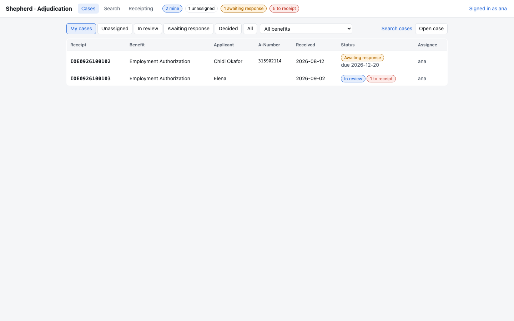

- Tabs: **My cases** (open, in review or awaiting response and assigned to you), **Unassigned**, **In review**, **Awaiting response**, **Overdue** (response due date passed, earliest first), **Decided**, **All**. The `N overdue` pill in the header opens **Overdue**.
- The benefit menu filters by form type.
- Status pills: `N to receipt` means documents in the case have open receipting tasks. `response overdue` means a notice's due date has passed.
- **Open case** creates a case from a stored document: pick the document, and optionally the benefit, receipt number (generated when empty) and received date.

### Search

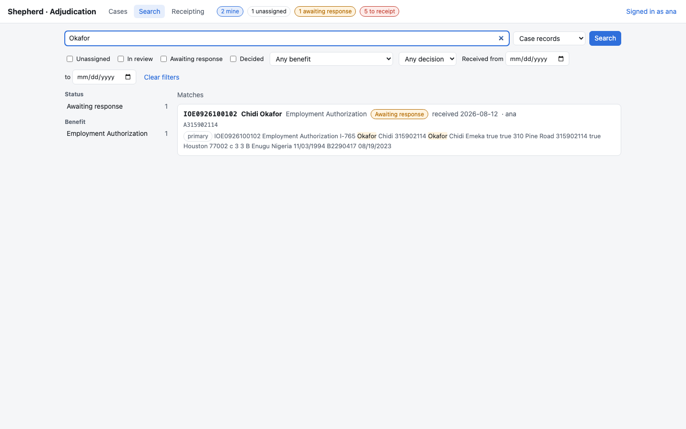

- Query by receipt number, A-Number, name, or any text. An exact receipt number or A-Number is listed first under **Exact match**.
- **Case records** searches case data. **All document text** also searches the text and form values of every document. Documents in no case are listed with **Open case**.
- Filters: status, benefit, decision, received date range. The facet counts on the left toggle the same filters.
- Without shepherd-search, results come from a database match on receipt number and names, and a note says so.

### Case view

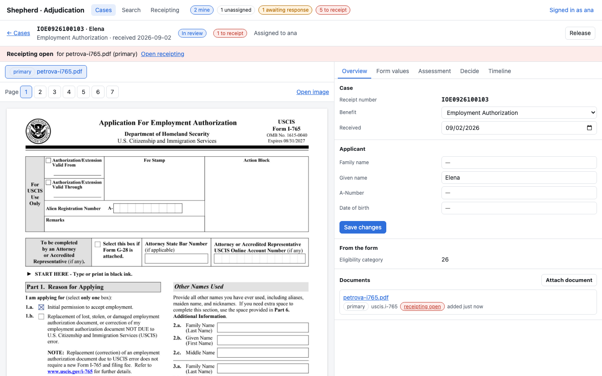

Header: receipt number, applicant, benefit, received date, status, assignee.

- Workers: **Request case** asks a manager to add the case to your workload; on your own case, **Request removal** asks to have it taken off. A pending request shows with **Withdraw**.
- Managers: **Assign** / **Reassign** picks a worker skilled for the benefit, showing each worker's load. Over capacity asks for confirmation. **Unassign** returns the case to the pool, where rules may assign it to another worker. Pending requests on the case are listed as banners with **Approve** and **Deny**.
- A case assigned to someone else is read-only for you. Assessment, notices and decisions require you to be the assignee.

Banners show what blocks progress:

| Banner | Action |
|---|---|
| Receipting open (red) | **Open receipting** opens the task. Completing it returns to the case. |
| Primary form not receipted (amber) | **Start receipting** creates a task for the primary document. |
| Request for evidence / Notice of intent to deny (amber) | **Record response** or **Rescind** closes the notice; **Extend due date** moves it. See [Notices](#notices). |
| Open findings (red) | **Review findings** opens the Overview tab. See [Findings](#findings). |
| Approved / Denied / Withdrawn / Administratively closed | **Reopen** (reason of 20+ characters). You become the assignee. |

Left pane: the document viewer. The bar above the page selects the case document (primary, supporting, response), then the page. Field boxes are drawn over the scan wherever a value exists. Clicking a box selects its field on the **Form values** tab. **Open image** opens the page PNG.

Right pane tabs:

**Overview**: case data (benefit, received date), applicant facts, values highlighted from the form, findings, documents, and notices. Facts are read from the primary form. Editing a fact and clicking **Save changes** asks for a reason and marks the fact `edited`, so later receipts no longer update it. **Reset** restores the form value. **Attach document** adds evidence. **Remove** detaches a non-primary document. **Make primary** (with a reason) makes a non-primary document the case's benefit form; the former primary becomes supporting, facts are read from the new form (your edits are kept), and a different benefit form changes the case's form type and clears assessments.

**Form values**: the values used for the selected document, with provenance:

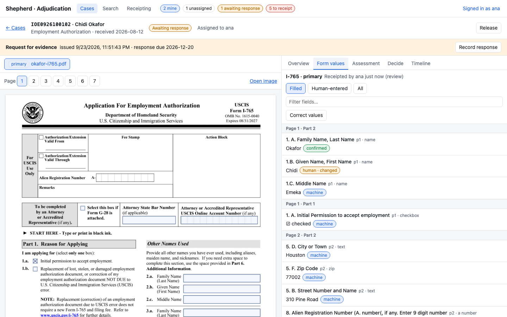

| Pill | Meaning |
|---|---|
| `machine` | Read by recognition, not touched by a reviewer. |
| `confirmed` | Reviewer kept the machine reading. |
| `human · changed` | Reviewer entered a value that differs from the machine reading. |

Filters: **Filled**, **Human-entered**, **All**. **Correct values** makes fields editable. Changed fields turn amber in the list and on the page. **Save corrections** asks for a reason and stores an amended receipt. It is unavailable while a receipting task is open.

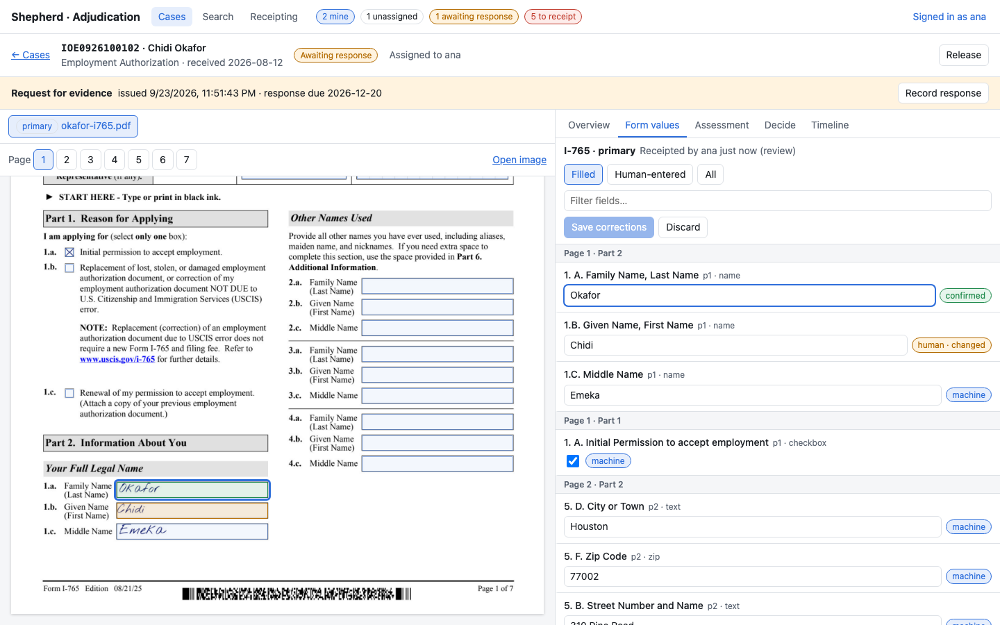

**Assessment**: each eligibility criterion from `config/benefits.toml` is recorded as **Met**, **Not met** or **N/A**. N/A applies only to criteria marked `if applicable`. **Not met** requires a note. Click the selected result again to clear it. Notes save when the field loses focus. Changing the benefit form clears all assessments and returns the case to the pool if the assignee is not skilled for the new form.

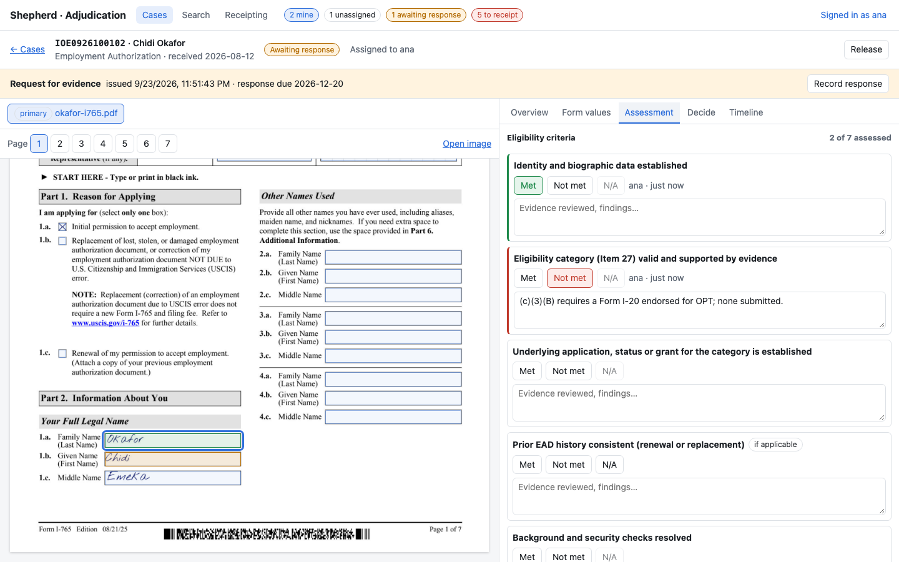

**Decide**: readiness checks and the four actions. Actions are disabled until you are the assignee.

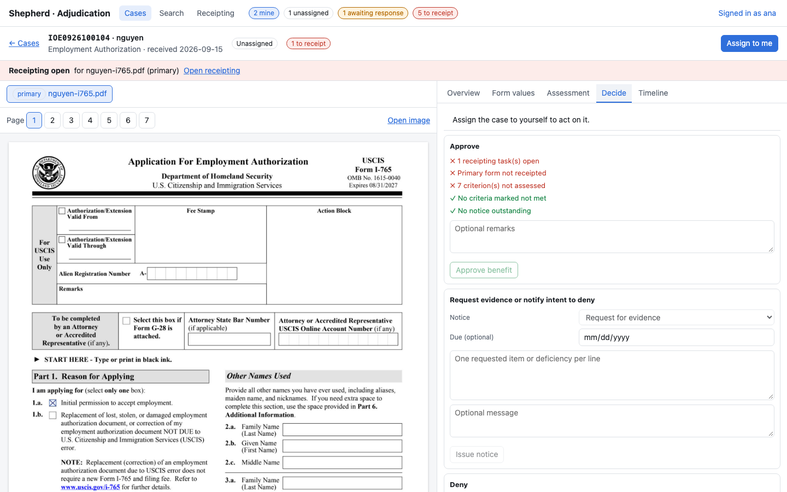

- **Approve**: every check must pass. A ✗ lists what is missing: open receipting tasks, primary form not receipted, criteria not assessed or not met, notice outstanding, open findings not dismissed.
- **Request evidence or notify intent to deny**: choose RFE or NOID, list one item per line, and optionally add a message and due date (default 87 or 33 days). Only available while the case is `in_review`.
- **Deny**: select one or more grounds and write a rationale of 20+ characters. The rationale is prefilled from criteria marked Not met. Receipting must be complete unless the ground is abandonment.
- **Record withdrawal**: rationale of 20+ characters.
- **Close administratively**: a reason (duplicate filing, opened in error, transferred, other) and an explanation of 20+ characters. No checks apply and no letter is sent. Managers can close any undecided case, including unassigned ones.

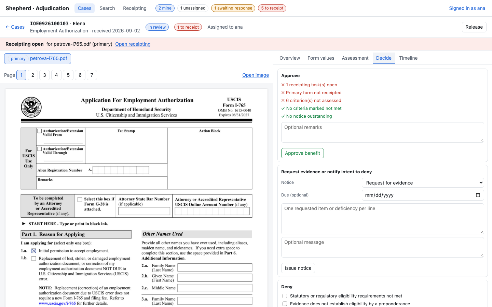

A decided case shows the decision record on this tab (renamed **Decision**): outcome, grounds, rationale, criteria, and open findings at decision time.

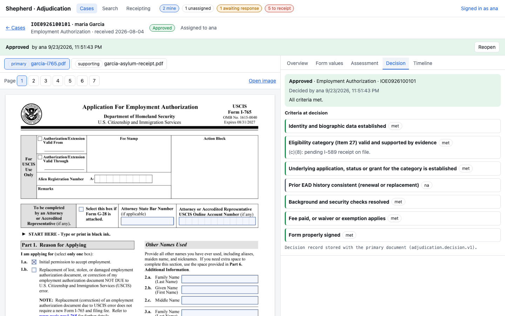

**Timeline**: every case action with actor and time, plus free-text notes. **Add note** appends to the case file.

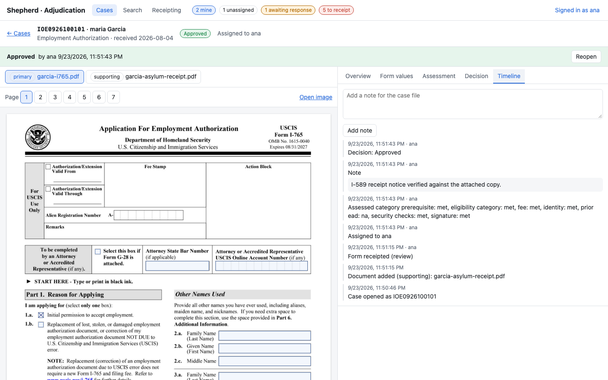

### Findings

Shown on **Overview** when shepherd-inference is configured. Each finding shows its severity, rule, summary, the parties involved (links open the other cases) and its review.

- **Confirm**: the conflict is real. Correct the case data (the finding resolves once the data no longer conflicts) or deny.
- **Dismiss**: not a conflict, e.g. a name change by marriage. A note is required.
- **Clear review**: back to not reviewed.

Only the assignee can review. Approval is blocked while a finding is open and not dismissed. A review is cleared by shepherd-inference when the related cases change.

### Notices

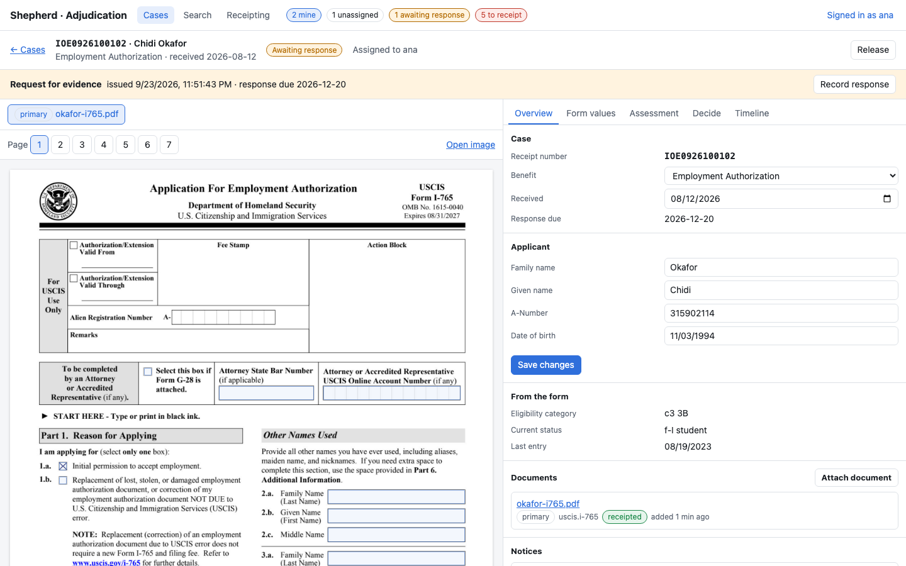

While a notice is outstanding the case is `awaiting_response` and the banner shows the due date.

- An upload labeled with the case's `receipt_number` is attached as `response` and closes the notice automatically.
- Otherwise use **Record response** and describe what was received.
- The case then returns to `in_review`.
- **Extend due date** (assignee): pick a date after the current due date and today, and give a reason. Allowed after the due date has passed. The banner and notice show the original date.
- **Rescind** (assignee): withdraws a notice issued in error; reason of at least 20 characters. The case returns to `in_review`. No letter is sent; notify the applicant separately.
- While a notice is outstanding, the only decisions available are withdrawal, and denial for abandonment after the due date.

## Workload

- **My workload**: your load against your maximum, skills, and whether automatic assignment is on. **My requests** lists your requests and their outcome; pending ones can be withdrawn.
- Managers also see:
  - **Pending requests**, oldest first, with **Approve** and **Deny** (optional note). Approving an addition over the worker's maximum asks for confirmation.
  - **Workers**: add a worker or click a row to edit the maximum, automatic assignment and skills. **Reassign cases** moves all of a worker's cases to another skilled worker. **Remove** requires the worker to hold no cases.
  - **Assignment rules**: add, edit (click a row) or delete. A rule names a benefit, optionally a list of workers (empty = every skilled worker), a priority and whether it is enabled. **Run assignment now** assigns the unassigned backlog immediately instead of waiting for the periodic sweep.

## Receipting

### Queue

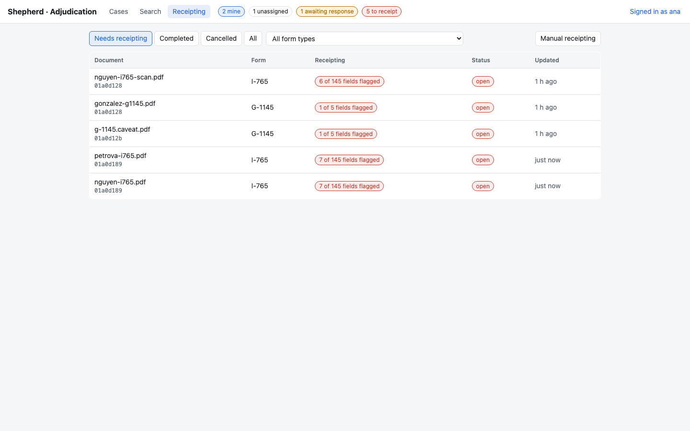

- Tabs: **Needs receipting** (open and in progress, oldest first), **Completed**, **Cancelled**, **All**, plus a form type filter.
- `N of M fields flagged` counts the fields recognition could not accept. `form type needed` means the document matched no template.
- **Manual receipting** opens a task for any stored document, optionally forcing the form type.

### Workbench

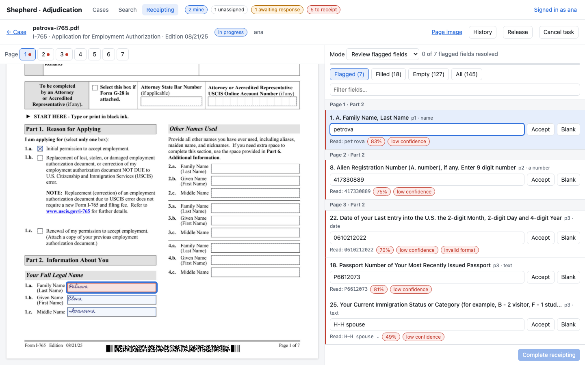

Opening a task claims it for you. If another reviewer holds it, the task opens read-only until they release it or the claim expires (`CLAIM_TTL_MINUTES`).

Left pane: the scanned page, with every field box aligned to the scan. Pages with unresolved flags show a red dot in the page bar.

| Box color | Meaning |
|---|---|
| Red | Requires receipting. |
| Green | Resolved by you. |
| Amber | Changed from the machine value. |
| Blue | Machine-read, accepted. |
| Dashed grey | Blank. |

Right pane: fields grouped by page and section. Filters: **Flagged**, **Filled**, **Empty**, **All**, plus a text filter. Each flagged field shows the machine reading (`Read:`), its confidence, and the reasons it was flagged (e.g. `low confidence`, `invalid format`).

- Edit the value, or use **Accept** (confirm the reading) or **Blank** (confirm the field is empty).
- **Enter** confirms the field and moves to the next flagged field.
- **Undo** discards your entry for the field.
- Clicking a box selects its field. Focusing a field scrolls to its box.

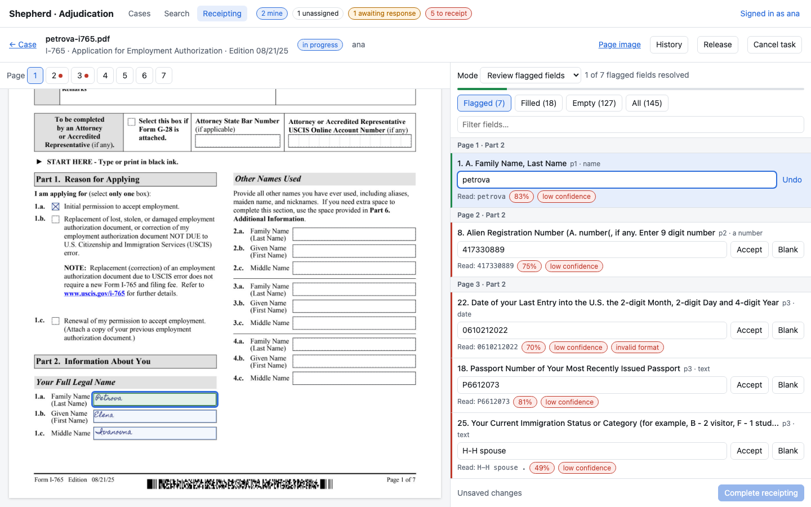

The progress bar counts resolved flagged fields. **Complete receipting** is enabled once all flagged fields are resolved. Validation errors are shown on the field. Drafts autosave ("Draft saved …").

Header actions:

- **Release**: saves the draft and frees the claim.
- **Cancel task**: closes the task without a receipt.
- **History**: lists task events.
- **← Case** / **← Queue**: goes back. After completion, the page returns to the case, or opens the next open task.

Other modes:

- **Full manual receipting** (Mode menu): all fields are entered by hand and machine values are ignored. Fields left empty are submitted blank, after a confirmation.
- **Form type not recognized** banner: choose the form, then **Set type** to enter values by hand, or **Set type and re-run recognition** to re-run recognition through intake. The task refreshes when recognition completes.
